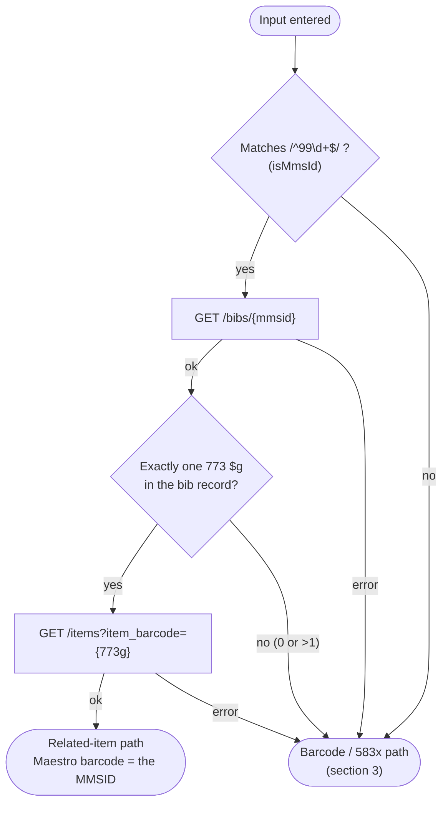
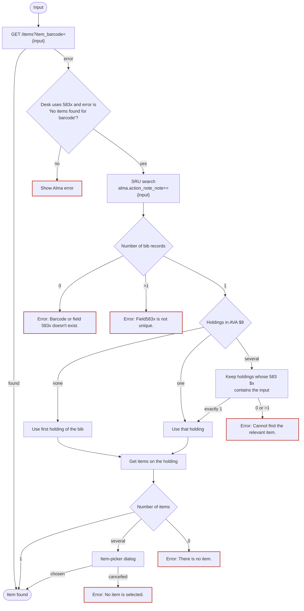
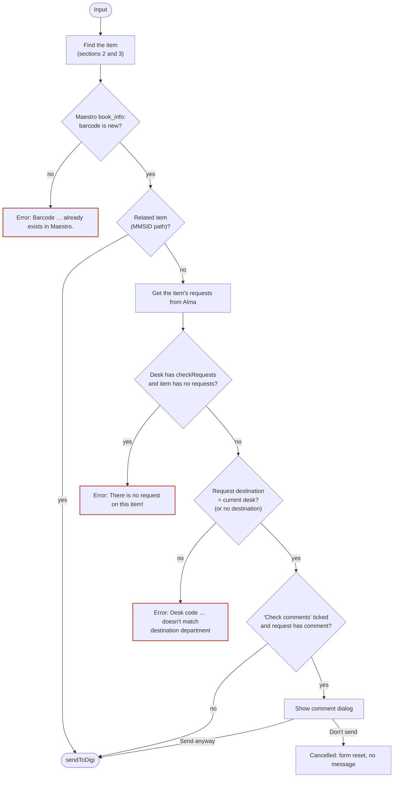
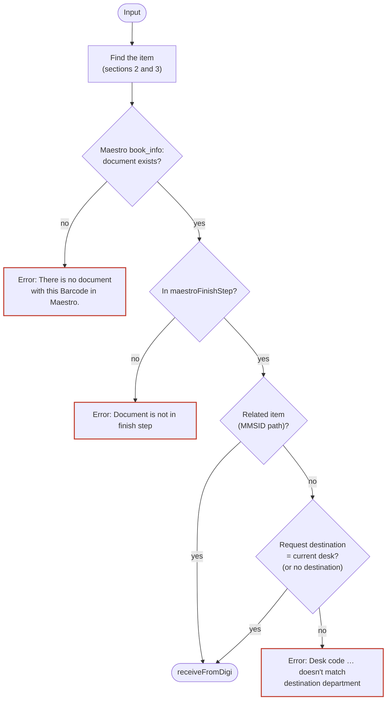

# App flow

This document describes what the app does with each value scanned or typed in, and which checks decide what happens
next. It is meant for developers; see [README.md](README.md) for the user-facing description.

Paths are relative to `cloudapp/src/app/`.

- [1. Startup](#1-startup)
- [2. Is the input an MMSID?](#2-is-the-input-an-mmsid)
- [3. Barcode / field 583x lookup](#3-barcode--field-583x-lookup)
- [4. Send to digitization](#4-send-to-digitization)
- [5. Receive from digitization](#5-receive-from-digitization)
- [6. Maestro API calls](#6-maestro-api-calls)
- [7. Things worth knowing](#7-things-worth-knowing)

## 1. Startup

`main/main.component.ts:30-54`

1. Read Alma init data: the library and department (desk) the user is currently at, institution code and Alma URL.
2. Load the app configuration and find the desk whose `deskCode` matches the current department.
3. Show an error if:
   - the configuration is empty → *"Please ask an Admin to configure this App."*
   - no desk is selected in Alma → *"Please select a Desk in Alma first."*
   - the current desk is not in the configuration → *"The desk you are at … is not defined in the app."*
4. Set the input label: *"Barcode or MMSID"*, or *"Barcode, MMSID or field583x"* if the desk has `useMarcField`.

The desk config, library code, institution and Alma URL are passed to the **Send** and **Receive** tabs.

## 2. Is the input an MMSID?

Both tabs start the same way (`send()` in `send-material/send-material.component.ts:260-275`, `receive()` in
`receive-material/receive-material.component.ts:119-133`): they first try to treat the input as an MMSID, and fall back
to the barcode / 583x lookup if that does not work.

1. `AlmaService.isMmsId` (`shared/alma.service.ts:331`) checks that the input is all digits and starts with `99`.
   Anything else (an ordinary barcode, a 583x value such as `NKS-4_4737_1`) goes straight to the barcode / 583x path,
   without calling `/bibs`. Alma rejects non-numeric ids on `/bibs/{id}` with error 4022150, which is why this check
   exists.
2. If it looks like an MMSID, the app fetches the bib record and reads the item barcode from MARC field **773 $g**
   (`AlmaService.getField773wgFromBibPost`, `shared/alma.service.ts:335-344`).
3. It then fetches the item with that barcode.
4. **Any error** in steps 2–3 is caught and turned into a marker value, and the input is handled as a barcode / 583x
   instead (section 3). The marker is `'Warning: The input is not a valid MMSID'` in Send and `'Input is not MMSID'` in
   Receive.
5. If everything succeeds, the item is a *related item* and the **MMSID itself** is used as the barcode in Maestro.

## 3. Barcode / field 583x lookup

`AlmaService.getItemFromAlma` and the methods after it (`shared/alma.service.ts:64-121`).

### Which value is sent to Maestro as the barcode

Once the item is found:

- By default it is the item's barcode (`item_data.barcode`).
- If the desk uses field 583x, the app reads 583 $x from the item's holding (`AlmaService.getField583x`,
  `shared/alma.service.ts:183-194`):
  - one 583 $x on the holding → that value is used;
  - several → the input text is used;
  - none → the item barcode is kept.
- On **Send** the chosen 583x value must also be unique across Alma (SRU `alma.all_for_ui`), otherwise
  *"Field 583x is not unique."* (`send-material/send-material.component.ts:197-220`). Receive does not make this check
  (`receive-material/receive-material.component.ts:67-68`).

## 4. Send to digitization

`send-material/send-material.component.ts`

### Checks before sending (barcode path)

1. **Not already in Maestro**: `book_info` must answer *"No book found with the barcode"*
   (`checkStatusInDigitization`, lines 89-98).
2. **Requests**: all of the item's requests are fetched (paged, see `AlmaService.getAllPages`). If the desk has
   `checkRequests`, there must be at least one request (lines 169-174).
3. **Desk**: if the first request has a target destination, it must equal the current desk code (lines 176-188,
   `AlmaService.checkIfdeskCodeIsDestination`).
4. **Comment**: if *Check comments* is ticked and the first request has a comment, a dialog shows it. *Don't send*
   cancels without an error (lines 190-195).

On the **related-item (MMSID) path** only check 1 is made; see [section 7](#7-things-worth-knowing).

### `sendToDigi` (lines 56-64)

1. Maestro `book_add` with the barcode, the desk's parameters and, when chosen, *Fraktur*, *Multivolume* and the note
   (as `field[title]`).
2. Maestro `book_info` to read back the new document.
3. If the document exists and is in the desk's `maestroStartStep`, Maestro `step_finish` moves it to the next step
   (lines 222-251).
4. Alma scan-in (`AlmaService.markItemAsUnavailable`): `op=scan` to the desk's department; with a work order type the
   item also gets status `digitaliseret1`. `library` is only sent when it differs from the institution code.
5. Success message: *"<barcode> with the title … is successfully sent to Maestro and Alma."*

If any step throws, the error is shown and the form reset. An HTTP failure against the Maestro URL is shown as
*"Cannot connect to digitization system. Please check your network connection!"* (lines 152-167).

## 5. Receive from digitization

`receive-material/receive-material.component.ts`

### Checks before receiving (barcode path, lines 61-98)

1. The document must exist in Maestro.
2. It must be in the desk's `maestroFinishStep`.
3. If the item's first request has a target destination, it must equal the current desk.

The related-item (MMSID) path makes checks 1 and 2 only.

### `receiveFromDigi` (lines 43-59)

1. Maestro `step_finish` for the `maestroFinishStep`.
2. Alma scan-in with `done=true` (`AlmaService.markItemAsAvailable`); with a work order type the status is
   `digitaliseret2`.
3. If the desk has `removeTempLocation` and the item's temporary location starts with `LFDOD`, the temporary location
   is cleared with a PUT on the item (`AlmaService.removeTemporaryLocation`).
4. Success message: *"… is successfully received in Maestro and Alma …"*.

## 6. Maestro API calls

All calls go through `DigitizationService.callApi` (`shared/digitization.service.ts:67-79`) as a POST to the
configured service URL, with the API key and `action` in the query string. If the URL or key is missing, the call
fails with *"serviceURL or apiKey undefined"*.

| Action | Used by | Parameters |
|---|---|---|
| `book_info` | Send and receive checks; read-back after `book_add` | `barcode` |
| `book_add` | Send | `barcode`, each desk parameter (names from config *Basics*), optional `field[Fraktur]=1`, `field[Multivolume]=1`, `field[title]=<note>` |
| `step_finish` | Send (start step), receive (finish step) | `barcode`, `step_name` |

A barcode counts as new when `book_info` returns `error: "No book found with the barcode"`.

## 7. Things worth knowing

These describe the current behaviour; they are not necessarily intended.

- **Silent MMSID fallback.** A `99…` input that fails anywhere on the MMSID path (bib not found, missing or repeated
  773 $g, item not found) is retried as a barcode / 583x without telling the user. The user only sees the error from
  the barcode path.
- **Fewer checks on the MMSID path.** When sending a related item, the request, desk and comment checks are skipped.
  When receiving one, the desk check is skipped.
- **The MMSID is the Maestro barcode** for related items, not the item barcode from 773 $g.
- **Maestro errors after `book_add` don't stop the Alma update.** If the read-back document is missing or not in the
  start step, an error alert is shown, but `sendToDigi` still scans the item in to Alma and then shows a success
  message (`throwErrorWithAlert` returns a value instead of throwing, lines 253-256).
- **The 583x uniqueness check runs only on Send.**
- **Only the first request** is used for the desk and comment checks.
- The "not an MMSID" marker strings differ between Send and Receive (section 2). Keep them in sync with their
  `concatMap` comparisons if you change them.
